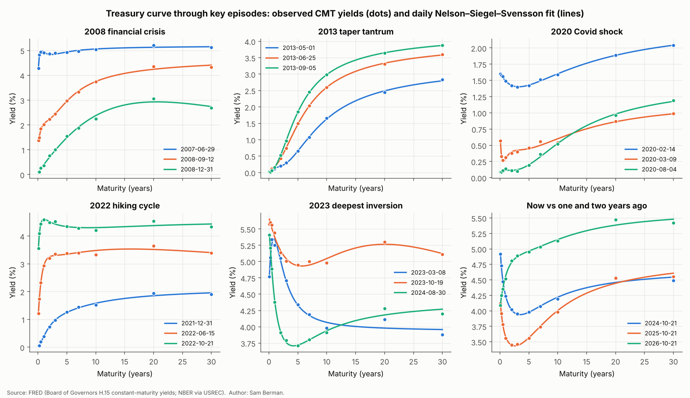
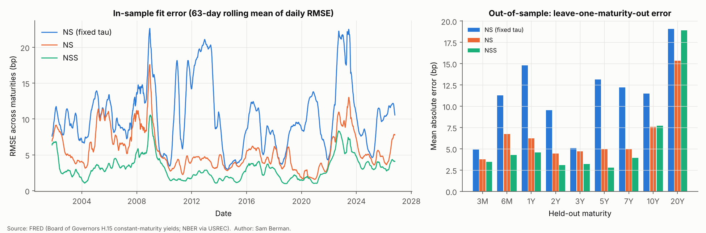
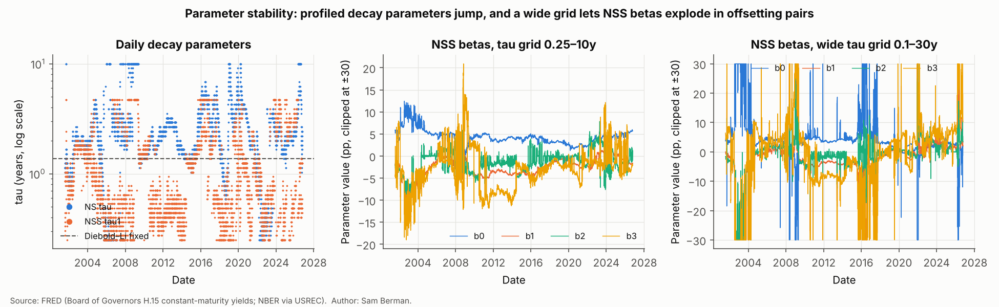
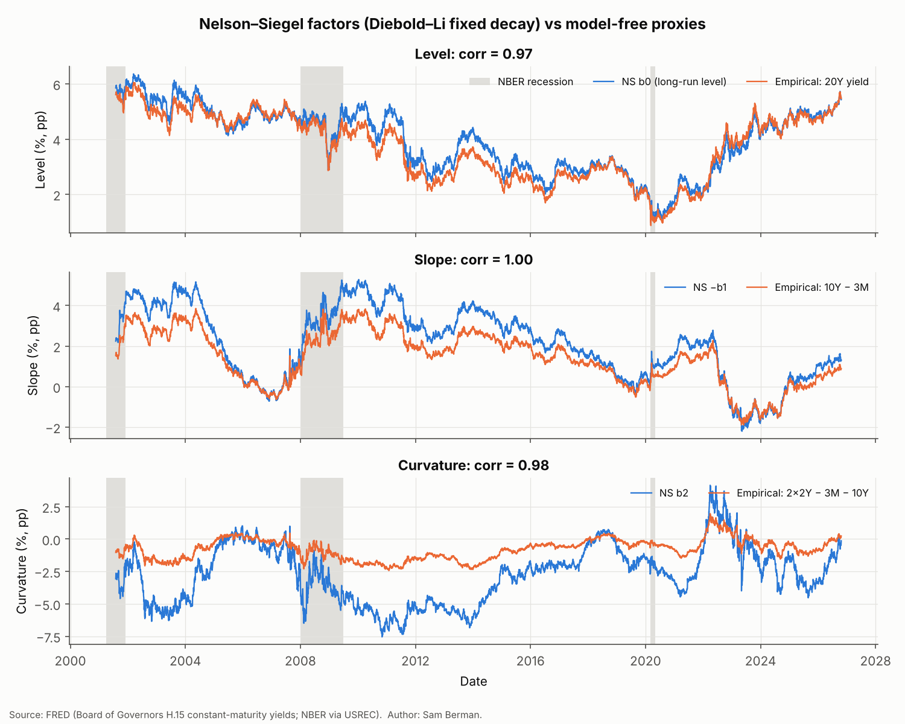
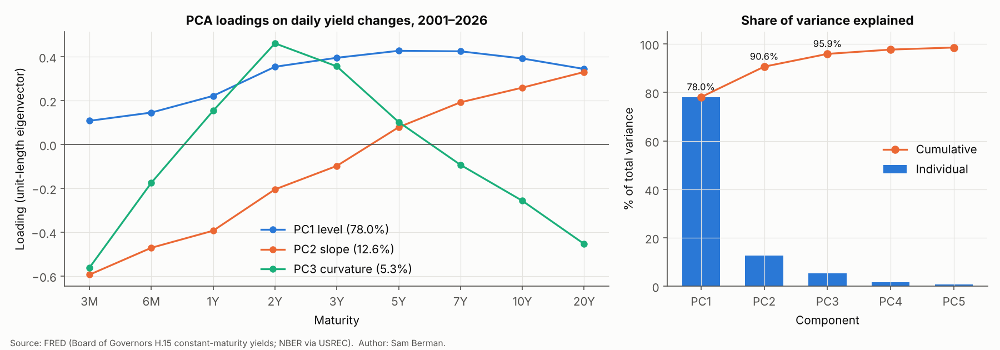
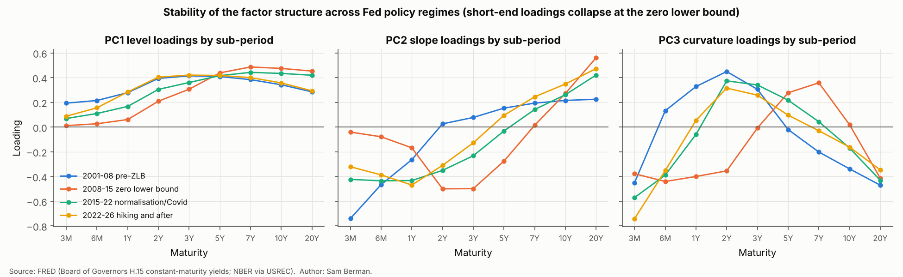
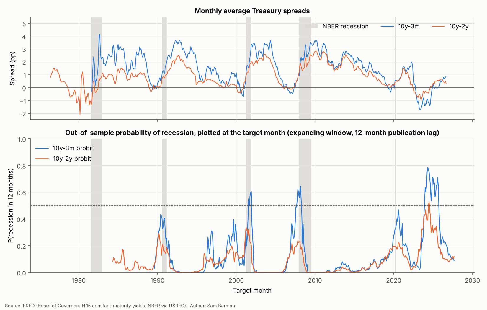
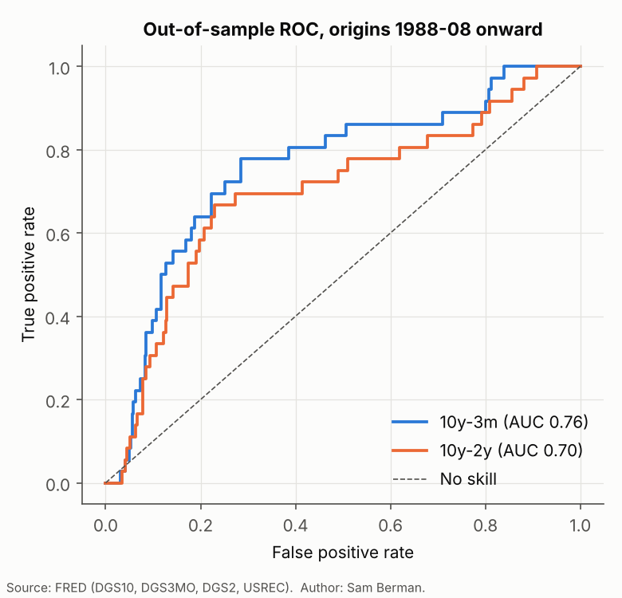
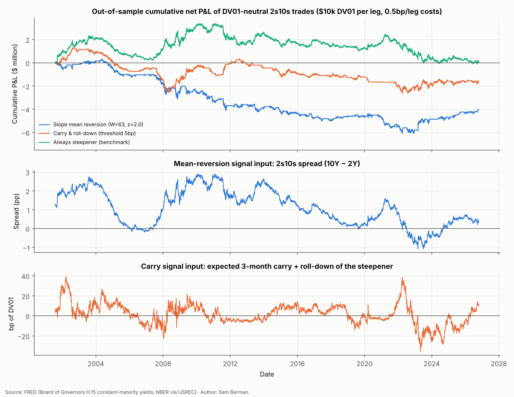

# US Treasury Yield Curve Modelling

**Sam Berman, University College Dublin**

**Headline result.** The sample is 6,308 trading days of FRED Treasury yields, from July 2001 to October 2026.
- A daily Nelson–Siegel–Svensson (NSS) model fits the 11-point curve with a mean error of **3.2bp**. When one maturity is held out and predicted from the others, the error is **5.8bp**.
- **Three principal components explain 95.9%** of daily yield changes. Loadings estimated on 2001–13 still explain 95.5% of 2014–26 changes.
- A 10y–3m probit model predicts recessions 12 months ahead out of sample with **AUC 0.76**, which beats chance. Its probability forecasts are not better than the historical base rate (Brier skill **−0.11**). The reason is the 2022–24 inversion: the model put recession odds at up to **78%**, and no recession has followed so far.
- Two DV01-neutral 2s10s trades were tested out of sample: slope mean reversion and carry & roll-down. **Neither makes money after transaction costs** (net Sharpe −0.32 and −0.14).

---

## Contents
1. [Question](#1-question)
2. [Data](#2-data)
3. [Method](#3-method)
4. [Results](#4-results)
5. [Limitations](#5-limitations)
6. [Reproduce in 3 commands](#6-reproduce-in-3-commands)
7. [Repository layout](#7-repository-layout)

Also: [`docs/methodology-qa.md`](docs/methodology-qa.md) answers the ten hardest interview questions about the method. [`notebooks/analysis.ipynb`](notebooks/analysis.ipynb) runs everything end to end, with outputs.

## 1. Question

How well do standard parsimonious models describe the US Treasury curve? And how much of that structure is useful?

1. **Fitting.** How accurately do Nelson–Siegel (NS) and Svensson (NSS) fit the curve each day? Are their parameters stable? How do the parameters map to level, slope and curvature?
2. **Factor structure.** Do three principal components really drive daily yield changes? Is that structure stable across Fed policy regimes?
3. **Recession signal.** Does the slope of the curve predict NBER recessions 12 months ahead *out of sample*? How should we read the 2022–24 inversion?
4. **Trading.** Can a DV01-neutral 2s10s steepener/flattener make money out of sample after costs?

## 2. Data

All data are free and come from FRED's public CSV endpoint (`fredgraph.csv?id=...`, no API key). The download, validation and caching code is in [`src/data.py`](src/data.py). Files are cached in `data/raw/`, which is gitignored.
- Stooq is coded as a fallback for the yield series. It was not needed: every series in this run came from FRED. (Stooq also blocked scripted access from the build environment.)
- No data are simulated anywhere. Synthetic numbers appear only as unit-test fixtures that check formulas.

| Series | Description | Frequency | First obs. used |
|---|---|---|---|
| `DGS1MO`, `DGS3MO`, `DGS6MO`, `DGS1`, `DGS2`, `DGS3`, `DGS5`, `DGS7`, `DGS10`, `DGS20`, `DGS30` | Treasury constant-maturity (par) yields, % p.a., bond-equivalent basis (Fed H.15) | Daily | see below |
| `USREC` | NBER recession indicator (1 = recession month) | Monthly | 1854 (used from 1976) |

**Samples.**

| Analysis | Maturities | Period | Why |
|---|---|---|---|
| Curve fitting and PCA | all 11 (PCA: 3M–20Y) | **2001-07-31 → 2026-10-21** | 2001-07-31 is the earliest date on which all eleven series exist (it is the first 1-month print) |
| Recession probits | 10Y, 3M, 2Y | 10y–3m from 1981-09; 10y–2y from 1976-06 | Each spread needs only two series, and the longer history adds the 1980, 1981–82 and 1990–91 recessions. With only the 2001+ sample there would be just two recessions to learn from |
| Curve trades | 3M, 1Y, 2Y, 7Y, 10Y | 1981-09 → 2026-10 | Parameters are chosen on 1981–2001, and **2001-07-31 onward is the untouched test period** |

**How missing maturities are handled.**
- **30Y, 2002-02-19 → 2006-02-08 (994 days): set to missing.** Treasury stopped issuing the 30-year bond in 2001. FRED's `DGS30` in this window is not a market yield. It is Treasury's *extrapolated* estimate, the 20-year CMT plus an adjustment factor. The series jumps **+17bp** on the first day of the window and **−16bp** on the day after it ends. Over the window, its daily changes correlate only 0.88 with the 20Y, compared with 0.98 afterwards. I treat those days as missing rather than pretend they are market data.
- **How each analysis copes with the 30Y gap:**
  - The NS/NSS fits use whichever maturities exist that day. The code groups days by their pattern of available maturities.
  - PCA uses only gap-free maturities.
  - The 20Y gap (1987–1993) falls outside the curve sample.
- **1M bill: included in the curve fits, but excluded from the main PCA.** Its daily changes are dominated by bill-supply and debt-ceiling effects. With the 1M included, PC2 is mostly a 1M factor (loading −0.76). Results with the 1M are reported as a robustness check.
- **Holidays.** Days on which every series is missing (bond-market holidays) are dropped. Zero bill yields during the zero-lower-bound (ZLB) years are real data and are kept.

## 3. Method

### 3.1 Nelson–Siegel and Svensson
For maturity $m$ (years) and decay parameters $\tau_1,\tau_2$:

$$y(m)=\beta_0+\beta_1\underbrace{\frac{1-e^{-m/\tau_1}}{m/\tau_1}}_{L_1}+\beta_2\underbrace{\left(\frac{1-e^{-m/\tau_1}}{m/\tau_1}-e^{-m/\tau_1}\right)}_{L_2}\;\left[+\;\beta_3\left(\frac{1-e^{-m/\tau_2}}{m/\tau_2}-e^{-m/\tau_2}\right)\right]_{\text{NSS}}$$

What the parameters mean:
- **Level:** $\beta_0=\lim_{m\to\infty}y(m)$.
- **Short rate and slope:** $\beta_0+\beta_1=y(0)$ is the instantaneous short rate, so $-\beta_1$ is the long-minus-short slope.
- **Curvature:** $\beta_2$ scales a hump that peaks at $m\approx1.79\,\tau_1$.

**Estimation by profile least squares.** For fixed $\tau$ the model is linear in $\beta$, so $\hat\beta(\tau)$ is plain OLS. I search a log-spaced grid, $\tau\in[0.25,10]$ years with 40 points. For NSS, every grid pair with $\tau_2\ge2\tau_1$ is tried, which keeps the two humps distinct. The fit with the smallest sum of squared errors wins. This finds the global optimum on the grid and avoids the local minima that non-linear NSS optimisers are known for. The whole fit is vectorised and runs on all 6,308 days in about one second.

**Four specifications:**
- NS with the Diebold–Li (2006) fixed decay, $\lambda=0.0609$/month, so $\tau=1/(0.0609\times12)=1.37$ years. This puts the curvature peak at about 30 months.
- NS with $\tau$ re-estimated each day.
- NSS.
- NSS on a wide grid ($0.1$–$30$ years), as a robustness check.

**Out-of-sample check.** For each interior maturity, I drop it, refit the curve on the remaining maturities, and predict the dropped yield. This is leave-one-maturity-out (LOO). A model that overfits shows a low in-sample RMSE but a high LOO error.

### 3.2 PCA of daily yield changes
I compute daily changes $\Delta y_t$ in bp (3M–20Y, 9 maturities, 6,307 days) and their sample covariance matrix $\Sigma$. Then I take the eigen-decomposition $\Sigma=V\Lambda V'$. The share of variance explained by component $k$ is $\lambda_k/\sum_j\lambda_j$. All maturities are in bp, so I use the covariance matrix, not the correlation matrix.
- **Sign conventions:** PC1 loadings sum to a positive number; on PC2 the long end loads above the short end; on PC3 the belly loads above the wings.
- **Sub-period stability.** I re-run the PCA in four Fed regimes and compare loadings using Tucker's congruence, $|v_a'v_b|/(\|v_a\|\|v_b\|)$. A value of 1 means the same shape.
- **Out of sample.** Eigenvectors $V_k$ are estimated on 2001–13, and I measure how much 2014–26 variance they explain: $\operatorname{tr}(V_k'\Sigma_{test}V_k)/\operatorname{tr}(\Sigma_{test})$.

### 3.3 Recession probits (Estrella & Mishkin, 1998)
$$\Pr(\text{USREC}_{t+12}=1\mid s_t)=\Phi(a+b\,s_t)$$

Here $s_t$ is the monthly average of the daily 10y–3m (or 10y–2y) spread.

**In-sample inference.** I estimate the full-sample probit with Newey–West (HAC, 12 lags) standard errors. HAC is needed because overlapping 12-month-ahead targets make the residuals serially correlated.

**Out of sample, with an expanding window.** At each origin month $t$, the model is re-estimated on pairs $(s_\tau,\text{USREC}_{\tau+12})$ with $\tau+12\le t-12$, and then $\Pr_t$ is forecast.
- The extra 12 months is an assumed **NBER publication lag**. NBER announces turning points 4–21 months after the fact. Without the lag, the model would train on recession dates nobody knew at the time.
- Forecasting starts at the first origin with at least 60 training months that include at least one recession month: **1988-08** for 10y–3m. The 1990–91 recession is therefore a genuine out-of-sample test.

**Evaluation:**
- **AUC.** I report a moving-block bootstrap 95% CI with 24-month blocks, which keeps recession episodes intact.
- **Brier score** $\frac1T\sum(p_t-y_t)^2$.
- **Brier skill score** against the expanding historical base rate.
- **Diebold–Mariano test** of equal Brier loss, using Newey–West variance with 12 lags and a Bartlett kernel.

### 3.4 DV01-neutral 2s10s trades
CMT yields are par yields, so each leg is treated as a par bond with a semi-annual coupon equal to its yield.

**Modified duration and convexity** come from the discounted cash flows:

$$MD=\frac{1}{P}\sum_t \frac{t}{f}\frac{CF_t}{(1+y/f)^{t+1}},\qquad C=\frac{1}{P}\sum_t \frac{t(t+1)}{f^2}\frac{CF_t}{(1+y/f)^{t+2}}$$

**DV01** is $N\cdot MD\cdot10^{-4}$. On 2026-10-21, DV01 per \$1mm was **\$188.5 for the 2y** and **\$774.7 for the 10y**.

**DV01 neutrality.** A steepener is long the 2y and short the 10y, with notionals that equalise the DV01s:

$$N_{10}\,DV01_{10}=N_2\,DV01_2\;\Rightarrow\;\frac{N_{10}}{N_2}=\frac{DV01_2}{DV01_{10}}\approx0.24$$

- A parallel 1bp move then makes about \$0. A 1bp steepening of 2s10s makes +1×DV01.
- Each leg is sized to **\$10,000 per bp**, which is \$53mm of 2y against \$13mm of 10y, and is re-sized daily.

**Daily P&L of one leg** per \$1 notional (yields in decimals, $dt$ in calendar days/365, $f$ = funding rate):

$$r_{t+1}=\underbrace{(y_t-f_t)\,dt}_{\text{carry}}+\underbrace{MD_t\,\big(y_t(T)-y_t(T-dt)\big)}_{\text{roll-down}}\;\underbrace{-\,MD_t\,\Delta y_{t+1}+\tfrac12 C_t\,(\Delta y_{t+1})^2}_{\text{price change}}$$

- Funding $f$ is proxied by the 3M CMT.
- Roll-down uses the slope between neighbouring CMT nodes (2y↔1y, 10y↔7y).
- Check on the approximation: for daily 10y moves since 1962, duration + convexity is within \$15.8 per \$10k DV01 of exact repricing on 99% of days. The worst day is 19 Oct 1987, with a \$582 error. Duration alone has a 99th-percentile error of \$2,180.

**Signals.** A position is decided at the close of day $t$ and earns the P&L of day $t+1$, so there is no look-ahead.
- **Slope mean reversion.** Compute $z_t=(s_t-\bar s_{t,W})/\sigma_{t,W}$ on the 2s10s spread. Go flattener if $z>k$ and steepener if $z<-k$. Exit when $z$ crosses 0. $W$ and $k$ are chosen from a 4×4 grid by **training-period (1981–2001) Sharpe only**.
- **Carry & roll-down.** Each leg's expected 3-month carry plus roll-down, in bp of DV01, is $\frac{(y-f)h}{MD}+[y(T)-y(T-h)]$. The steepener's value is the 2y leg minus the 10y leg. Go steepener if this exceeds the threshold, flattener if it is below minus the threshold. The threshold is chosen on training data.
- **Benchmark:** always steepener.

**Transaction costs:** 0.5bp of yield per leg per trade, as an assumption. The quoted half-spread on on-the-run 2s and 10s is roughly 0.1–0.4bp, so this allows for slippage. Sensitivity from 0 to 2bp is reported.

**Statistics:**
- annualised \$ P&L and volatility
- Sharpe ratio
- Newey–West t-statistic of mean daily P&L, with its p-value
- maximum drawdown and turnover

## 4. Results

All tables are written by the pipeline to [`results/`](results/). Headline numbers are in [`results/key_numbers.json`](results/key_numbers.json).

### 4.1 Curve fitting



*An animated version, month-end curves 2001–2026, is in [`figures/curve_animation.gif`](figures/curve_animation.gif).*

| Model | Free params / day | Mean RMSE (bp) | 95th pct RMSE (bp) | **LOO MAE (bp)** | Days with \|β\|>20pp | Median \|Δb2\| per day (bp) |
|---|---|---|---|---|---|---|
| NS, fixed τ (Diebold–Li) | 3 | 10.4 | 20.4 | 11.3 | 0% | 8.1 |
| NS, τ estimated | 4 | 5.6 | 11.1 | 6.5 | 0% | 9.1 |
| **NSS** | 6 | **3.2** | 6.8 | **5.8** | 0.03% | 16.3 |
| NSS, wide τ grid (0.1–30y) | 6 | 2.6 | 5.5 | 6.9 | **11.3%** | 20.3 |



- **NSS fits best both in and out of sample.** Its main gain over NS is at the short end and in the belly, where LOO error falls from 6–7bp to 3–4bp. The 20Y is the hardest point for every model (LOO error 15–19bp). On 35% of days since 2006 the 20Y yield has been *above* the 30Y. That hump at the long end is something these smooth functional forms cannot capture.
- **Fit quality depends on the regime.** NSS errors were about 1.5bp in the quiet ZLB years (2010–2021) and 6.5bp in 2008 and 2022. In those years the front end moved sharply and the curve took on shapes these functional forms struggle with.
- **The wide grid shows how NSS overfits.** It lowers in-sample RMSE (2.6bp against 3.2bp) but raises LOO error (6.9bp against 5.8bp). On 11% of days the betas explode in offsetting pairs, because $\beta_0$ becomes unidentified when $\tau$ is beyond the longest maturity.

**Parameter stability.** The decay parameter jumps around when it is profiled daily. 9% of NS days sit at a grid edge. The NSS $\beta_2$ and $\beta_3$ change by a median of 16bp a day, twice as much as in the fixed-τ NS. This is the usual trade-off: **fixing τ costs accuracy but makes the betas interpretable, smooth time series.** That is why the Diebold–Li specification is the one used to map factors below.



**How the NS parameters map to level, slope and curvature** (fixed-τ NS, correlation in levels):

| Factor | NS parameter | Empirical proxy | Corr. (levels) | Corr. (daily Δ) |
|---|---|---|---|---|
| Level | $\beta_0$ | 20Y yield | 0.97 | 0.97 |
| Level | $\beta_0$ | (3M+2Y+10Y)/3 | 0.60 | 0.70 |
| Short rate | $\beta_0+\beta_1$ | 3M yield | 1.00 | 0.79 |
| Slope | $-\beta_1$ | 10Y − 3M | 1.00 | 0.93 |
| Curvature | $\beta_2$ | 2×2Y − 3M − 10Y | 0.98 | 0.85 |

$\beta_0$ is the *long-end* level. That is why it tracks the 20Y closely, but the Diebold–Li average-of-three proxy only loosely: at the ZLB that proxy is pulled down by zero short rates. When τ varies daily the mapping weakens (curvature correlation 0.64), because the meaning of $\beta_2$ changes with τ.



### 4.2 PCA

| | PC1 (level) | PC2 (slope) | PC3 (curvature) | PC1–3 |
|---|---|---|---|---|
| **Variance explained, 3M–20Y, 2001–26** | **78.0%** | **12.6%** | **5.3%** | **95.9%** |
| Std. dev. of factor (bp/day) | 14.0 | 5.6 | 3.6 | |
| Robustness: add 1M | 68.2% | 17.3% | 7.2% | 92.7% |
| Robustness: all 11 maturities (2006–26) | 65.8% | 17.9% | 8.3% | 92.0% |



**What the components look like.**
- **PC1** loads positively on every maturity, peaking at 5–7Y: a near-parallel *level* shift.
- **PC2** changes sign from −0.59 at 3M to +0.33 at 20Y: *slope*.
- **PC3** is positive in the 2–3Y belly and negative at both ends: *curvature*.
- Daily PC scores correlate 0.79, 0.76 and 0.75 with daily changes in the NS $\beta_0$, $-\beta_1$ and $\beta_2$. The statistical factors and the NS factors describe the same three movements.

**Stability across regimes.**

| Sub-period | PC1–3 var. | PC1 congruence | PC2 congruence | PC3 congruence |
|---|---|---|---|---|
| 2001–08 pre-ZLB | 96.4% | 0.99 | 0.93 | 0.91 |
| 2008–15 zero lower bound | 96.5% | 0.95 | **0.52** | **0.24** |
| 2015–22 normalisation/Covid | 94.7% | 0.99 | 0.95 | 0.93 |
| 2022–26 hiking and after | 96.5% | 0.99 | 0.94 | 0.94 |

Three factors explain about 95–97% of variance in *every* regime. The *shapes* of the factors, however, are not fixed:
- At the zero lower bound the front end was pinned, with 3M–1Y PC1 loadings near zero.
- PC2 became a "2–3Y versus long end" factor, and curvature moved out to the 5–7Y sector (congruence 0.24 with the full-sample PC3).

So a hedge built on full-sample PCs would have been mis-specified at the ZLB.



**Out of sample.** PC1–3 estimated on 2001–13 explain **95.5%** of the variance of 2014–26 changes. The 2014–26 sample's own PCs explain 95.7%.

### 4.3 Recession prediction

**Full-sample probit**, HAC standard errors:

| Spread | Sample | $b$ | z (HAC) | p-value | McFadden $R^2$ |
|---|---|---|---|---|---|
| 10y–3m | 1981-09 – 2025-09 | −0.43 | −2.76 | 0.006 | 0.13 |
| 10y–2y | 1976-06 – 2025-09 | −0.76 | −2.66 | 0.008 | 0.18 |

**Out of sample** (expanding window, 12-month publication lag; both spreads evaluated on the common window of origins 1988-08 to 2025-09, 446 months, 36 of them recession months):

| Spread | AUC [95% block-bootstrap CI] | Brier | Brier (base rate) | Brier skill | DM p-value |
|---|---|---|---|---|---|
| **10y–3m** | **0.76** [0.58, 0.95] | 0.086 | 0.078 | −0.11 | 0.69 |
| 10y–2y | 0.70 [0.49, 0.96] | 0.075 | 0.078 | +0.04 | 0.69 |
| *10y–3m, origins to 2021-12* | *0.81* [0.63, 0.97] | 0.068 | 0.086 | *+0.20* | 0.22 |
| *10y–2y, origins to 2021-12* | *0.75* [0.53, 0.99] | 0.073 | 0.085 | *+0.14* | 0.047 |



- **Ranking (AUC).** The 10y–3m spread ranks recession months above non-recession months out of sample, with AUC 0.76. Its CI excludes 0.5. The 10y–2y does worse (0.70) and its CI includes 0.5, which matches Estrella–Mishkin's finding that the 3-month bill is the better short leg. Out-of-sample probabilities rose ahead of the 1990, 2001 and 2008 recessions. Covid (2020) was not a curve-driven recession, and the 2019 inversion only coincidentally preceded it.
- **Calibration (Brier).** The models do *not* beat the naive base rate over the full window, and the Diebold–Mariano tests cannot reject equal accuracy (p ≈ 0.69). The full-sample 10y–3m slope is significant in sample (p = 0.006), but that does not turn into significantly better probability forecasts out of sample.

**The 2022–24 inversion.**
- The 10y–3m monthly spread was negative continuously for **25 months (2022-11 to 2024-11)**, reaching **−1.73pp**. It then dipped marginally below zero again for a few months in 2025. That is the longest and deepest inversion in the sample since 1981.
- The out-of-sample 10y–3m probit gave probabilities above 50% for 22 origin months, peaking at **78% in May 2023**. That forecast was for May 2024. No NBER recession has been declared through the latest USREC observation (2026-09).
- This one episode is what turns the 10y–3m Brier skill from +0.20 (origins up to 2021) to −0.11. Over the full window, at the 50% threshold, the model made 26 false-alarm months against 7 correct ones.
- As the false alarm enters the training window, the estimated slope coefficient flattens from −0.76 (at the May 2023 origin) to −0.45 (latest). That is the expanding window "learning" that inversions have become less reliable.
- Plausible reasons, which I cannot test separately here:
  - a term premium that was compressed by QE, so an inverted curve now signals less;
  - household and corporate balance sheets that had termed out their debt at low fixed rates before the hikes;
  - large fiscal deficits;
  - the possibility that the curve inverted because markets expected *disinflationary* rate cuts rather than a downturn.
- It is also possible that the signal is just late. Historical lags from inversion to recession have ranged from about 6 to 24 months. Recent USREC labels are provisional, because NBER dates recessions retrospectively.
- **Latest forecast:** from the 2026-09 spreads, P(recession in 2027-09) = **8.9%** (10y–3m) and 12.1% (10y–2y).



### 4.4 Curve trades (DV01-neutral 2s10s, \$10k DV01 per leg)

**Out of sample, 2001-07-31 → 2026-10-21, net of 0.5bp/leg costs:**

| Strategy (parameters chosen on 1981–2001) | Ann. P&L | Ann. vol | Sharpe | NW t-stat | p-value | Max DD | Trades/yr |
|---|---|---|---|---|---|---|---|
| Slope mean reversion (W=63d, entry \|z\|>2) | −\$161k | \$508k | **−0.32** | −1.69 | 0.09 | −\$6.4mm | 6.3 |
| Carry & roll-down (threshold 5bp) | −\$67k | \$492k | **−0.14** | −0.75 | 0.45 | −\$4.0mm | 17.0 |
| Always steepener (benchmark) | +\$2k | \$620k | 0.00 | 0.02 | 0.99 | −\$3.5mm | — |

Out-of-sample Sharpe at different cost levels:

| Cost (bp/leg) | 0 | 0.25 | 0.5 | 1 | 2 |
|---|---|---|---|---|---|
| Mean reversion | −0.19 | −0.26 | −0.32 | −0.44 | −0.68 |
| Carry & roll-down | +0.21 | +0.04 | −0.14 | −0.48 | −1.12 |



- **Mean reversion fails in and out of sample.** Every one of the 16 parameter pairs had a *negative* training Sharpe, between −0.24 and −0.53. Grid selection could only pick the least bad. Over horizons of weeks to months the 2s10s spread trends with the policy cycle rather than reverting. The mirror-image trend rule, checked *after* seeing the results and so not a valid test, earns a Sharpe of only 0.07 out of sample (p = 0.72).
- **Carry & roll-down earned a 1.09 Sharpe in training (1981–2001), but almost all of that came from always being a steepener.** Over 1981–2001 the always-steepener earned \$789k a year, mostly from carry (\$268k) and roll-down (\$431k) in a steep, falling-rate curve. Out of sample, the carry signal has a small gross edge (Sharpe 0.21, not significant). It flips about 17 times a year, so costs above 0.25bp/leg wipe that edge out.
- **Attribution of the always-steepener, 2001–26 (per year):**
  - roll-down +\$74k
  - carry −\$3k (the 2y yields little more than the 3M funding rate)
  - duration −\$37k
  - convexity −\$32k

  The convexity term is a structural cost: per unit of DV01 the 10y leg has more convexity than the 2y, so a DV01-neutral steepener is **short convexity**.

**Conclusion.** These two textbook 2s10s rules have no reliable edge over 2001–26 after realistic costs. That is consistent with an efficient, heavily traded segment of the curve.

## 5. Limitations

- **The yields are CMT par yields, not tradable bonds.** P&L treats each maturity as a constant-maturity par bond re-struck daily. It ignores on-the-run/off-the-run spreads, repo specialness, coupon effects and the futures basis. Funding is proxied by the 3M CMT, not GC repo. DV01 re-hedging costs are ignored.
- **Roll-down uses linear interpolation between CMT nodes.** A fitted curve would give slightly different numbers.
- **Transaction costs are a single assumed number**, with sensitivity reported. Market impact for \$50mm+ clips in stressed markets would be larger.
- **The recession models rest on few events.** There are only 5–6 recessions in the estimation samples (36 recession months out of sample), so every out-of-sample statistic has wide confidence intervals: for example, the AUC CI spans 0.58–0.95.
- **The 12-month publication lag is an approximation.** NBER lags vary from 4 to 21 months. The latest USREC zeros are provisional.
- **The probit uses only the spread.** It deliberately excludes the level of rates, credit spreads and the term premium, so it tests the classic one-variable model, not the best possible model.
- **NS/NSS results depend on the τ grid.** That choice is a modelling decision, shown here with a wide-grid robustness check. The NSS ordering constraint $\tau_2\ge2\tau_1$ is a convention for identification, not a theory.
- **The PCA sub-periods were chosen by Fed regime before looking at loadings.** Other splits would give somewhat different numbers.
- **The trade parameter grids are small (16 and 4 combinations)** and are reported in full ([`results/trades_train_grid_*.csv`](results/)) to limit data-snooping concerns.

## 6. Reproduce in 3 commands

```bash
pip install -r requirements.txt   # Python 3.13; pinned versions
python -m src.pipeline            # downloads FRED data (cached in data/raw/), writes figures/ and results/  (~2 min)
pytest                            # 46 offline tests of the core calculations
```

To re-execute the notebook with outputs:

```bash
jupyter nbconvert --to notebook --execute --inplace notebooks/analysis.ipynb
```

Because FRED keeps adding new days, a fresh run will extend the sample past 2026-10-21 and numbers will move slightly. Delete `data/raw/` to force a re-download.

## 7. Repository layout

```
src/
  data.py        FRED download + cache, Stooq fallback, 30Y masking
  curves.py      Nelson–Siegel / Svensson loadings, profile-LS fitting, LOO errors
  pca.py         PCA, sign conventions, congruence, sub-period and out-of-sample checks
  recession.py   probits, expanding-window OOS forecasts, AUC/Brier/DM, block bootstrap
  bonds.py       par-bond price, duration, convexity, DV01, hedge ratio
  trades.py      DV01-neutral P&L decomposition, signals, backtest, Newey–West stats
  plots.py       figure style
  pipeline.py    runs everything; writes figures/ and results/
notebooks/analysis.ipynb   end-to-end run with outputs
tests/                     pytest suite (hand-computed / textbook values)
figures/                   PNG charts + curve animation
results/                   CSV tables + key_numbers.json
docs/methodology-qa.md     ten hardest questions, with answers
CV_BULLETS.md              CV bullets
```

**References.**
- Nelson & Siegel (1987), *Journal of Business*.
- Svensson (1994), NBER WP 4871.
- Diebold & Li (2006), *Journal of Econometrics*.
- Litterman & Scheinkman (1991), *Journal of Fixed Income*.
- Estrella & Mishkin (1998), *Review of Economics and Statistics*.
- Diebold & Mariano (1995), *JBES*.
- Gürkaynak, Sack & Wright (2007), *Journal of Monetary Economics*.

MIT licence.
