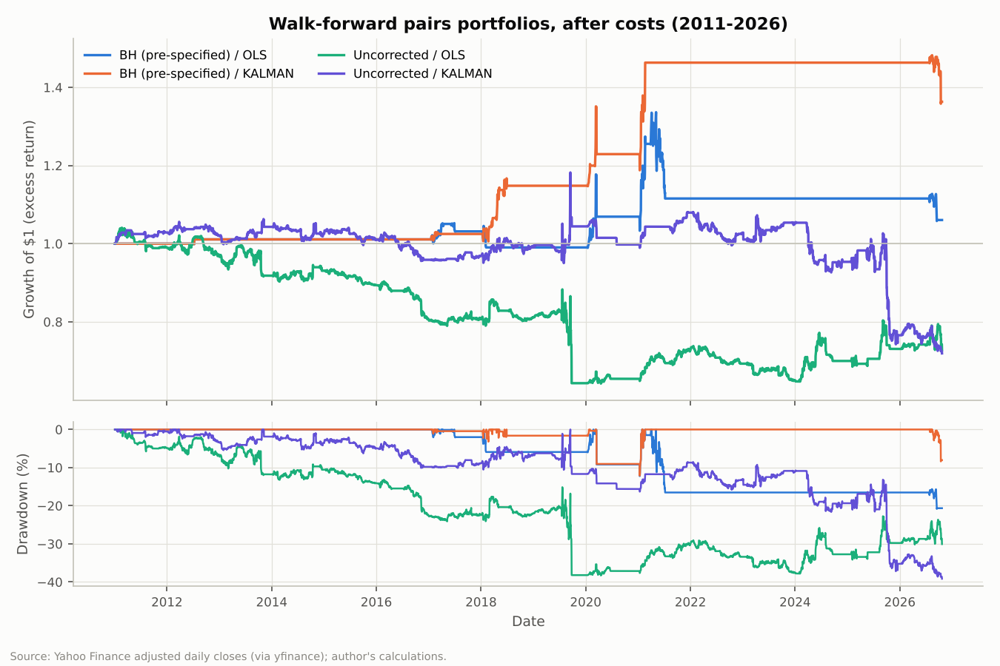
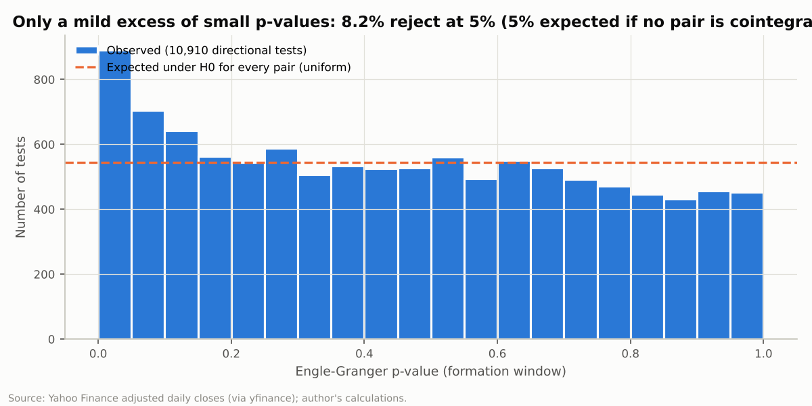
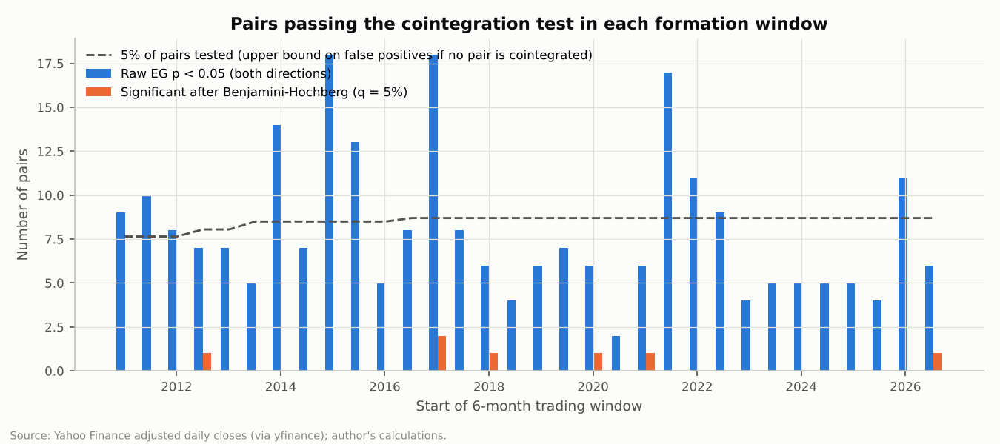
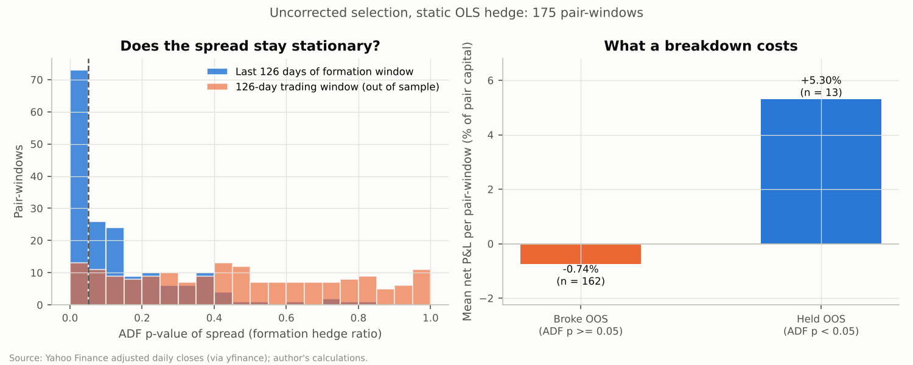
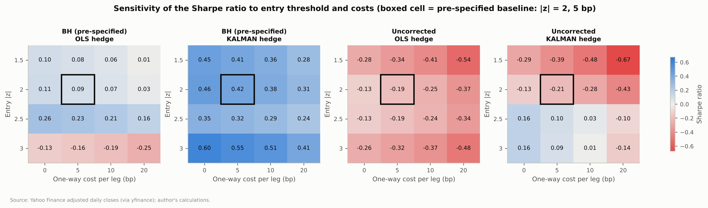
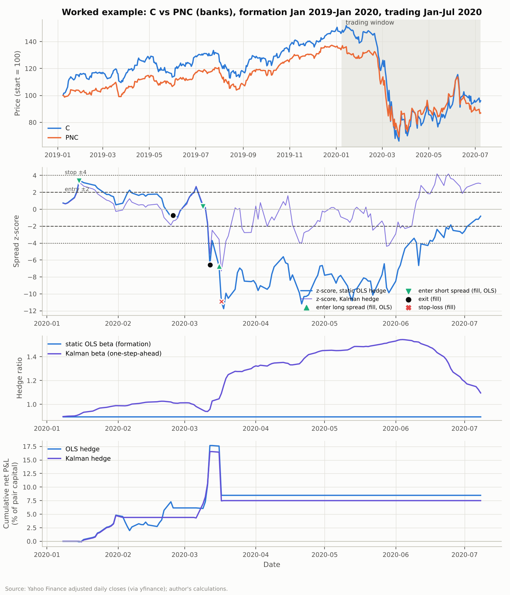

# Cointegration pairs trading on US large caps (2011–2026): does it survive a multiple-testing correction?

**Sam Berman, University College Dublin**

**Headline result.** Across 32 walk-forward formation windows (5,455 within-industry pair tests on 53 US large caps and ETFs), the Engle–Granger test rejects "no cointegration" only slightly more often than chance (8.2% of directional tests at the 5% level, against 5% under the null). After a Benjamini–Hochberg correction just **7 pair-windows** survive in 16 years, and the pre-specified strategy sits in cash 93% of the time. That portfolio earns a Sharpe ratio of **0.09** with a static OLS hedge and **0.42** with a Kalman hedge, after costs. **Neither is statistically significant** (Newey–West p = 0.66 and 0.08). Skipping the correction gives 175 pair-windows and a tradable book, but it loses money: Sharpe **−0.19 (OLS)** and **−0.21 (Kalman)**. In that book **93%** of selected pairs fail an out-of-sample ADF test, against 58% for the same test on the end of the formation window. Returns are uncorrelated with the S&P 500 (β ≈ −0.01 to −0.03, all insignificant). The honest conclusion: classic cointegration pairs trading on liquid US large caps showed no reliable edge over 2011–2026 once costs and data-snooping are accounted for.



---

## 1. Question

Can a textbook statistical-arbitrage strategy make money out of sample after realistic costs? The strategy picks cointegrated stock pairs within an industry, then trades their spread back to equilibrium. The project asks three things:

1. Do formation-window cointegration tests identify relationships that **persist** in the next six months?
2. Does a **time-varying (Kalman) hedge ratio** beat a static OLS hedge ratio?
3. How much of any apparent edge is **data-snooping**? That is, picking "significant" pairs out of hundreds of tests, or picking the best cell of a parameter grid.

## 2. Data

| Item | Choice |
|---|---|
| Source | Yahoo Finance daily **adjusted** closes (splits and dividends) via `yfinance` 1.7.0, cached to `data/raw/` (gitignored). Stooq was coded as a fallback but was not needed (it was also unreachable from the build environment). FRED was not needed: returns are self-financing excess returns. Every series is real downloaded data; nothing is simulated. |
| Sample | 4 Jan 2010 – 22 Oct 2026 (4,227 trading days). The first formation window is 2010; trading runs 3 Jan 2011 – 22 Oct 2026 (15.8 years). |
| Benchmark | SPY (S&P 500 total-return proxy) |
| Data checks | Daily log moves above 25% are listed in `results/data_quality_large_moves.csv`. All match known events (the March 2020 crash, earnings, the Modelo deal). The COP/PSX spin-off is correctly adjusted. MPC, PSX and PYPL enter the universe only once they have a full formation window of history. |

**Universe (pairs are formed only within a group):**

| Group | Tickers | Pairs |
|---|---|---|
| Energy | XOM CVX COP EOG OXY SLB HAL VLO MPC PSX | 45 |
| Banks | JPM BAC C WFC USB PNC GS MS | 28 |
| Payments / cards | V MA AXP COF PYPL | 10 |
| Beverages | KO PEP MNST STZ TAP BF-B | 15 |
| Semiconductors | INTC TXN ADI QCOM NVDA AMD MU AMAT LRCX KLAC | 45 |
| Utilities | DUK SO AEP D XEL ED NEE WEC | 28 |
| ETF pairs | EWA/EWC (Australia/Canada), GLD/GDX (gold/miners), EWG/EWQ (Germany/France) | 3 |

**Survivorship bias.** The universe is chosen in 2026 from firms that are large, liquid and still listed today. That leaves out firms that were in these industries in 2010 but were later acquired, merged or delisted: Anadarko, Noble Energy, BB&T/SunTrust (now Truist), Xilinx, Linear Technology, Maxim, Altera, SCANA and others. For pairs trading the bias cuts in a specific direction. Acquisitions and delistings are the textbook way a "cointegrated" pair breaks permanently, often with a jump. Excluding them **flatters** the results, mostly through fewer large stop-losses. Since the strategy already fails to make money, a point-in-time universe (for example CRSP constituents by date) would most likely make it look worse, not better. Industry groups are also current classifications, not point-in-time ones.

## 3. Method

The timeline repeats every 126 trading days:

```
|---------- formation: 252 days ----------|---- trading: 126 days ----|
  test, select, estimate hedge (only here)   trade with frozen rules
                                           |---------- formation ----------|---- trading ----|  (next window)
```

Trading windows do not overlap, so each day belongs to exactly one portfolio. There are 32 windows.

### 3.1 Pair selection (formation window only)

For every within-group pair, using log prices $y_t, x_t$:

- **Engle–Granger.** Regress $y_t = \alpha + \beta x_t + u_t$ by OLS, then run an ADF test on $\hat u_t$ (lags chosen by AIC) using MacKinnon cointegration p-values. The test depends on which series is the regressand, so it is run **both ways** and the **larger** p-value is kept. A pair must reject in both directions, which removes the freedom to choose the favourable ordering.
- **Benjamini–Hochberg** at FDR $q=5\%$ across *all* pairs tested in that window (153–174 tests). Sort the p-values $p_{(1)}\le\dots\le p_{(m)}$ and reject the $k^*$ smallest, where $k^*=\max\{k: p_{(k)}\le kq/m\}$.
- **Johansen trace test** (constant in the cointegrating relation, one lagged difference) must also reject rank 0 at 5%. It is used as a confirmation filter only, because statsmodels gives critical values rather than p-values.
- **Half-life** from an AR(1)/discrete Ornstein–Uhlenbeck fit to the spread $s_t$:
  $$\Delta s_t = a + b\,s_{t-1} + \varepsilon_t,\qquad \phi = 1+b,\qquad \text{HL} = \frac{\ln 2}{-\ln \phi}.$$
  The half-life must lie between 2 and 63 trading days (63 is half the trading window).
- The hedge ratio must be positive. At most 20 pairs are kept, ranked by p-value.

### 3.2 Signals

**Static OLS hedge.** The spread is $s_t = y_t - \hat\alpha - \hat\beta x_t$, with $\hat\alpha,\hat\beta,\bar s,\hat\sigma_s$ all frozen from the formation window:
$$z_t = \frac{s_t - \bar s}{\hat\sigma_s}.$$

**Kalman-filter hedge.** The state is $\theta_t=(\alpha_t,\beta_t)'$ and follows a random walk:
$$y_t = \alpha_t + \beta_t x_t + e_t,\; e_t\sim N(0,R);\qquad \theta_t=\theta_{t-1}+w_t,\; w_t\sim N(0,W).$$
It is initialised from the formation OLS fit: $\theta_0=\hat\theta_{OLS}$, $P_0=R(X'X)^{-1}$, with $R$ the formation residual variance. The state noise is $W=\delta R\,(X'X/n)^{-1}$. This scaling makes $\delta$ unit-free: $\delta=10^{-3}$ lets the fitted equilibrium drift by about 0.5 residual standard deviations over six months. $\delta$ was **fixed in advance**, not fitted. The signal is the standardised one-step-ahead prediction error, so day $t$'s z-score uses $\theta_{t|t-1}$, which is estimated from data up to $t-1$:
$$z_t = \frac{y_t - (1, x_t)\,\theta_{t|t-1}}{\sqrt{F_t}},\qquad F_t=(1,x_t)P_{t|t-1}(1,x_t)'+R.$$

**Rules (identical for both hedges):**
- Enter short the spread when $z_t\ge 2$, or long when $z_t\le -2$.
- Exit when $z$ crosses 0.
- Stop-loss at $|z|\ge 4$, after which the pair is disabled for the rest of the window.
- No entry if $|z|$ is already at or above 4. All positions close on the last day of the window.
- **Execution lag:** the signal comes from the close of day $t$ and the fill is at the close of $t+1$.

### 3.3 Positions, costs and returns

- **Dollar-neutral:** $1 long and $1 short per $1 of pair capital, held as fixed share quantities until exit. A consequence worth knowing: P&L follows $r_y - r_x$, not exactly $\Delta s_t$ when $\beta\neq1$. Weighting the legs by the hedge ratio is reported as a robustness check.
- **Transaction costs:** 1 bp commission plus 4 bp spread/slippage = **5 bp per leg per side** on traded notional, so a round trip costs about 20 bp of pair capital.
- **Short borrow:** 50 bp a year on the short leg's market value, charged daily. This is general-collateral pricing for liquid large caps.
- **Capital:** returns are on **committed capital** (Gatev, Goetzmann and Rouwenhorst, 2006). Each selected pair gets an equal share of capital whether or not it trades, and a window with no pairs earns 0. The book is self-financing, so returns are **excess returns**. Interest on collateral and the short rebate are assumed to offset the risk-free rate.
- **Inference:** the t-tests on mean daily returns, the Kalman-minus-OLS difference and the SPY regression all use Newey–West (HAC) standard errors with $\lfloor 4(n/100)^{2/9}\rfloor$ lags.

### 3.4 What was fixed in advance

Everything in `src/config.py:StrategyConfig` was set **before the first backtest**:

- 252/126-day windows, BH at q = 5%, the Johansen filter, half-life of 2–63 days, at most 20 pairs;
- entry 2 / exit 0 / stop 4, a one-day lag, dollar neutrality, 5 bp costs, 50 bp borrow, Kalman δ = 10⁻³.

The **uncorrected** specification (raw p < 0.05) was planned as a comparison. It gets more space in the write-up than planned because the BH specification turned out too sparse to evaluate the trading rules on its own. The sensitivity grid (entry ∈ {1.5, 2, 2.5, 3} × cost ∈ {0, 5, 10, 20} bp) is **reported, not optimised**.

## 4. Results

### 4.1 Selection: few pairs are cointegrated beyond chance

| Statistic (5,455 pair-windows) | Value |
|---|---|
| Directional EG tests rejecting at 5% | **8.2%** (5% expected if no pair were cointegrated) |
| Storey estimate of the share of true nulls ($\pi_0$, λ = 0.5) | 0.89 |
| Pairs rejecting in both directions (raw p < 0.05) | 4.7% |
| Johansen trace rejects at 5% | 12.2% (over-rejects in short samples) |
| Significant after Benjamini–Hochberg | **7** (in 6 of 32 windows; 26 windows have none) |
| Selected, uncorrected specification | 175 |




There is a mild excess of small p-values, so *some* pairs are cointegrated in some windows. With about 170 tests per window and only 252 observations each, the test cannot single them out reliably. Most "significant" pairs at the raw 5% level are what you would expect from chance.

### 4.2 Portfolio performance (after costs, 3 Jan 2011 – 22 Oct 2026)

| | BH / OLS | BH / Kalman | Uncorrected / OLS | Uncorrected / Kalman | SPY |
|---|---|---|---|---|---|
| Annual return | 0.4% | 2.0% | −2.0% | −2.1% | 14.1% |
| Annual volatility | 6.3% | 5.0% | 8.6% | 8.4% | 17.0% |
| **Sharpe ratio** | **0.09** | **0.42** | **−0.19** | **−0.21** | 0.86 |
| t-stat (Newey–West) | 0.44 | 1.78 | −0.80 | −0.96 | 3.89 |
| p-value | 0.66 | 0.08 | 0.43 | 0.34 | <0.001 |
| Max drawdown | −20.8% | −12.1% | −38.3% | −39.1% | −33.7% |
| Turnover (× capital per year) | 2.5 | 3.8 | 10.3 | 12.3 | – |
| Round-trip trades | 12 | 16 | 225 | 242 | – |
| Hit rate (net P&L > 0) | 50% | 88% | 49% | 55% | – |
| Avg. holding period (days) | 23 | 11 | 33 | 20 | – |
| Time with ≥1 open position | 7% | 5% | 76% | 64% | – |
| Beta to S&P 500 (p) | −0.03 (0.25) | −0.03 (0.23) | −0.01 (0.36) | −0.01 (0.25) | – |
| Correlation with S&P 500 | −0.07 | −0.10 | −0.02 | −0.02 | – |

**Kalman vs OLS** (mean daily return difference, Newey–West): +1.5% a year under BH (t = 1.46, p = 0.14), and −0.1% a year uncorrected (t = −0.05, p = 0.96). **There is no significant difference.** The BH/Kalman result (Sharpe 0.42, alpha p = 0.049 against SPY) rests on 16 trades in 7 pair-windows. Its mean-return test gives p = 0.08, and it is the best of four specifications, so I do not treat it as evidence of an edge.

### 4.3 Out-of-sample breakdown of cointegration

The breakdown test is an ADF test on the trading-window spread, using the **formation** α and β. Because the coefficients are not re-estimated, ordinary ADF critical values apply. An ADF on 126 days has low power, so the same test on the **last 126 days of the formation window** serves as a power benchmark.

| Uncorrected selection, 175 pair-windows | Formation (benchmark) | Trading window (OOS) |
|---|---|---|
| Spread still rejected as non-stationary at 5% | 41.7% | **7.4%** |
| "Broke" (fails to reject) | 58.3% | **92.6%** |

Breakdown is costly:

- Pairs that **held** out of sample made **+5.3%** of pair capital per window on average (n = 13).
- Pairs that **broke** lost **−0.7%** (n = 162).
- With the OLS hedge, **50% of trades end in a stop-loss**. Summed over trades, the stopped-out trades lost 5.88 units of pair capital and all other trades made +5.37. In plain terms, breakdowns more than wipe out the convergence profits.



**Kalman hides breakdowns from the stop-loss.** With the Kalman hedge only 10% of trades hit the stop, against 50% for OLS, but that is not good news. When a relationship breaks, the filter re-estimates the equilibrium toward the new prices, so the z-score drifts back to 0 and the trade closes as a "convergence" at a large loss. The three worst Kalman trades lost 43%, 37% and 31% of pair capital (INTC/MU in 2024; TXN/MU and ADI/MU in Sep–Oct 2025, during MU's memory rally), and all three closed on the exit rule, not the stop. An adaptive hedge needs a stop based on P&L, not on z.

### 4.4 Sensitivity grid (reported, not optimised)



- Under the uncorrected selection, **all 16 OLS cells are negative**, even at zero cost. The Kalman hedge turns positive only at entry ≥ 2.5 with costs ≤ 10 bp, and peaks at 0.16. Costs steadily reduce the Sharpe ratio, by about 0.06 per extra 5 bp.
- The best of the 64 cells is BH / Kalman / entry 3.0 / zero cost: Sharpe 0.60, p = 0.050 on **5 trades**. Its Bonferroni-adjusted p-value across 64 cells is 1.0. Reporting that cell as "the result" would be exactly the over-fitting the grid is meant to expose.
- Robustness (`results/robustness.csv`): hedge-ratio weighting, dropping the Johansen filter, Kalman δ = 10⁻⁴ or 10⁻² and a same-close fill all leave every specification insignificant at 5%. The smallest p-value is 0.059, for BH/Kalman with hedge-ratio weighting, which again rests on 16 trades.

### 4.5 Worked example: C vs PNC (BH-selected), January–July 2020



1. **Formation (Jan 2019 – Jan 2020).** log C = −0.19 + 0.90 log PNC. EG p < 0.0001 in both directions, Johansen rejects, half-life 3.8 days. It is the only pair to pass BH in that window.
2. **14 Jan 2020:** z = +2.07, meaning C is rich relative to PNC. The rule shorts $1 of C and buys $1 of PNC, filled at the 15 Jan close. The spread converges and the trade exits on 25 Feb for **+6.2%** net.
3. **6 Mar:** z = +2.65, so the rule shorts again, filled 9 Mar. The COVID sell-off drives the spread straight through its mean to z = −6.6, and the trade closes on 12 Mar for **+11.5%**. That gain is luck, not mean reversion: the spread overshot by six standard deviations.
4. **13 Mar:** z = −3.70, so the rule buys the spread, filled 16 Mar at z = −6.8. The spread keeps diverging to z = −10.9, and the stop-loss fills on 17 Mar for **−9.2%**.
5. **Net:** +8.5% of pair capital (OLS) and +7.5% (Kalman). The Kalman hedge ratio moved from 0.90 to 1.5 during the crisis. The out-of-sample ADF p-value is 0.53, so the pair "broke" but still made money. Breakdown and losses are related, not identical.

Every number above is recomputed by hand from raw prices in `notebooks/analysis.ipynb`, section 6.

## 5. Limitations

- **Survivorship bias** in the universe (Section 2) probably flatters the results.
- **Low power.** One-year formation windows give EG tests limited power. Longer windows, for example 3 years, would detect more true relationships but would assume relationships stay stable for longer. This trade-off was not explored, to avoid another parameter search.
- **Dependent tests.** BH assumes independent or positively dependent tests, but pairs that share a stock are dependent. Benjamini–Yekutieli would be stricter still and would leave even fewer pairs, so the conclusion stands.
- **Small samples.** With only 7 BH pair-windows, the BH results have very wide confidence intervals. A Sharpe of 0.42 over 15.8 years has a standard error of roughly 0.25.
- **Costs are assumptions.** The 5 bp per leg per side figure is a reasonable 2011–2026 estimate for large caps, but costs were higher early in the sample and around events. Borrow fees are a flat 50 bp, with no hard-to-borrow episodes and no recalls.
- **Execution.** Fills are at the close with a one-day lag. There is no intraday modelling and no market impact beyond the slippage figure.
- **Dollar neutrality vs the hedge ratio.** Dollar-neutral legs do not replicate the cointegrating spread when β ≠ 1. The hedge-ratio-weighted variant is in the robustness table and does not change the conclusion.
- **Kalman δ is a modelling choice.** The z-score is the one-step prediction error, which adapts toward the data. Section 4.3 shows the downside.
- **Out of scope:** intraday data, distance or copula pairs methods, machine-learning selection, and transaction-level borrow data.

## 6. Reproduce in 3 commands

```bash
pip install -r requirements.txt
python -m src.run_pipeline          # downloads and caches data (~1 min), then runs everything (~2 min)
python -m pytest -q                 # 48 unit tests of the core calculations
```

To re-execute the notebook with outputs: `jupyter nbconvert --to notebook --execute --inplace notebooks/analysis.ipynb`. The notebook source is generated by `notebooks/build_notebook.py`.

## Repository layout

```
src/config.py        universe, dates, pre-specified parameters
src/data.py          download + cache (Yahoo -> Stooq fallback), data-quality screen
src/cointegration.py Engle-Granger, Johansen, Benjamini-Hochberg, half-life, selection
src/kalman.py        Kalman filter hedge ratio
src/backtest.py      walk-forward engine, signals, P&L with costs, OOS diagnostics
src/metrics.py       Sharpe, drawdown, turnover, Newey-West tests, beta to SPY
src/plots.py         figures
src/run_pipeline.py  orchestration -> results/*.csv, results/summary.json, figures/*.png
notebooks/           analysis.ipynb (executed, with outputs)
tests/               pytest checks against hand-computed values
docs/methodology-qa.md  the hardest interview questions, answered
```

## References

- Engle, R. and Granger, C. (1987). Co-integration and error correction. *Econometrica*.
- Johansen, S. (1991). Estimation and hypothesis testing of cointegration vectors. *Econometrica*.
- Benjamini, Y. and Hochberg, Y. (1995). Controlling the false discovery rate. *JRSS B*.
- Gatev, E., Goetzmann, W. and Rouwenhorst, K. G. (2006). Pairs trading: performance of a relative-value arbitrage rule. *Review of Financial Studies*.
- Do, B. and Faff, R. (2010). Does simple pairs trading still work? *Financial Analysts Journal*.
- Rad, H., Low, R. and Faff, R. (2016). The profitability of pairs trading strategies: distance, cointegration and copula methods. *Quantitative Finance*.
- Newey, W. and West, K. (1987, 1994). HAC covariance and automatic lag selection.
- Storey, J. (2002). A direct approach to false discovery rates. *JRSS B*.

## License

MIT (see `LICENSE`).
